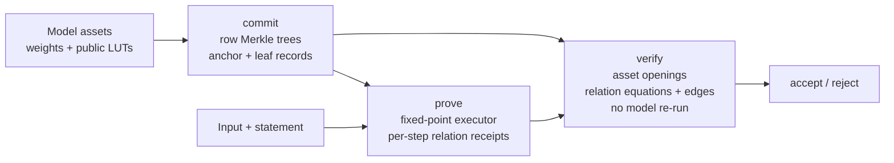

# zkIE

**Verifiable fixed-point inference with a three-stage commit / prove / verify
pipeline.**

> Status: under development. The current implementation supports GPT-2 124M,
> Gemma 3 270M and TimesFM 1.0 200M. Proofs are not zero-knowledge: weights,
> lookup tables and activations are public witness data.

zkIE proves that the output of a committed model on a public input is exactly
the fixed-point result of running that model. The verifier checks the statement,
the public model commitment and the proof; it never re-runs the model and never
reads the model weights.

## What is proven

For a statement `(model_commitment, input, expected_output)` and an optional
expected token choice, the prover shows:

- the statement is bound to the public model commitment and to the input;
- every weight and lookup table read by the execution is an opening of the
  committed model;
- every operator step satisfies its algebraic relation on the opened inputs,
  outputs and intermediate vectors;
- data flows between steps match the declared producer/consumer edges;
- the final output, or the final token choice, equals the statement's expected
  value.

The verifier accepts only when all of the above checks pass.

## Pipeline



### commit

The commit stage reads the model's weight and lookup-table assets, hashes their
rows into Merkle trees, and builds a shared model commitment:

- each asset is described by `asset_id`, path, element count, row width and
  encoding (`i32-le` or `i64-le`);
- rows are hashed into leaves; the leaves form a per-asset Merkle tree;
- a `LeafRecord` binds the table identity and the tree root;
- an `AnchorRecord` binds the model commitment, the parameters digest and all
  leaf records;
- `ModelCommitmentPublic` carries only the anchor and per-asset metadata, not
  weight values.

The commit artifact contains the public model commitment, the provider
configuration, the protocol description and a private parameters file. The
verifier needs only the public part.

### prove

The prove stage consumes an existing commit artifact, re-opens the committed
assets by `(asset_id, row range)`, and executes the model's fixed-point
executor. Every operator step produces a relation receipt:

- the opcode and its relation configuration (dimensions, shifts, clamps, table
  descriptors);
- an oracle registry containing the Merkle roots used by the step;
- committed input, output, raw-accumulator, quotient, range-helper and
  auxiliary vectors, each opened with Merkle paths;
- a mapping from selected inputs to the shared asset pool, so a weight or LUT
  interval is committed once per trace and referenced by later steps;
- a mapping from local inputs to earlier step outputs.

The serialized `SharedTrace` (tokens, asset openings, steps, final argmax and
final output) is the proof.

### verify

The verify stage loads the public model commitment, the statement, the proof
and the public inputs. For every asset opening it checks the link proof to the
anchor and the Merkle path of every opened row. For every step it rebuilds the
oracle registry, checks the op-specific relation on the opened values, and
checks the producer/consumer edges. Finally it checks the claimed argmax or
output tensor. The operator's forward routine is never called.

## Shared model commitment and public LUTs

Weights and lookup tables use the same commitment path. A LUT is an asset like
any other: its rows are committed at commit time, opened once per trace, and
referenced as an external input by the steps that read it. The verifier checks
the opening against the same anchor and Merkle root as a weight opening, so a
prover cannot substitute a different table.

## Supported operators

The live executors use these operators:

`add`, `affine_scale`, `argmax`, `gated_ffn`, `hadamard`, `index_gen`,
`matmul`, `projection`, `profile_norm`, `profile_rms`, `profile_rope`,
`profile_standardize`, `relu`, `softmax`, `softmax_rows`, `table_lookup`.

Each operator has a fixed-point forward implementation and an algebraic
relation checked by the verifier over opened vectors. Integer rounding uses an
explicit shift and mathematical floor; no host floating point participates in
the witness.

## Models

| Model | Input shape | Executor |
| --- | --- | --- |
| GPT-2 124M | 16 or 512 tokens | `models/gpt2` |
| Gemma 3 270M | 16 or 512 tokens | `models/gemma3` |
| TimesFM 1.0 200M | 16 patches from 512 raw points | `models/timesfm` |

Model weights and lookup tables are external, gitignored assets under each
model's `weights/` directory. `scripts/` contains the extraction and
fixed-point simulation helpers used to produce them. The model crates contain
only the fixed-point configuration and the shared-trace executor.

## Run it

Build and test the workspace:

```bash
cargo build --workspace
cargo test --workspace
```

Run the three stages with `zkie-bench`:

```bash
# commit: build and publish the shared model commitment
cargo run --release -p zkie-bench -- commit \
  --case <case.toml> \
  --assets-manifest <assets-manifest> \
  --parameters <parameters.bin> \
  --out <commit-dir> \
  --run-dir <run-dir>

# prove: execute the committed model and write the proof
cargo run --release -p zkie-bench -- prove \
  --commit <commit-dir> \
  --input <input.bin> \
  --model-id <model-id-hex> \
  --out <proof-dir> \
  --run-dir <run-dir>

# verify: check the public commitment, statement and proof
cargo run --release -p zkie-bench -- verify \
  --public <commit-dir>/public \
  --statement <proof-dir>/statement.bin \
  --proof <proof-dir>/proof.bin \
  --public-inputs <proof-dir>/public-inputs.bin \
  --model-id <model-id-hex> \
  --policy <policy-file> \
  --run-dir <run-dir>
```

`zkie-bench run` performs commit, prove and verify in one command; see
`zkie-bench help` for its flags. `matrix`, `decode-matrix` and
`profile-matrix` repeat the same stages over case lists and record per-stage
measurements.

`zkie-check` validates supporting material:

```bash
cargo run --release -p zkie-check -- contract --scope <scope> --matrix <matrix>
cargo run --release -p zkie-check -- assets --root <asset-root> --cases <case.toml>... --out <report>
cargo run --release -p zkie-check -- report --input <run-dir> --require-profile <name>
```

## Verification boundary

- **No witness hiding.** Weights, lookup tables, activations and intermediate
  vectors are public in the proof.
- **Hash-based commitments.** Commitment nodes and transcripts use
  domain-separated hashes; the field layer provides Goldilocks base-field and
  cubic-extension arithmetic for kernel primitives.
- **Public statement.** The verifier trusts the case configuration and policy
  it is given, and binds them to the commitment and proof through the statement.
- **No model re-execution.** Verification reads the public commitment, the
  statement, the proof and the public inputs only.
- **Performance.** Current commit/prove/verify timings, peak memory and proof
  sizes are **待测** (to be measured); no performance figures are recorded in
  this document.

## License

Apache-2.0. See [`LICENSE`](LICENSE).
