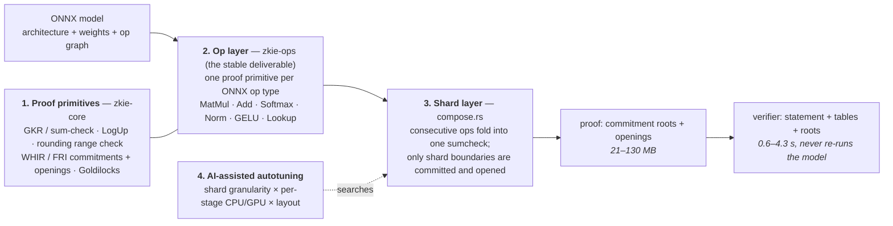

<div align="center">
    
</div>

# zkIE

> **Under development.** zkIE is not a usable release. The proof primitives, the
> op layer and the shard layer are implemented and tested; the AI-assisted
> autotuning built on top of them is still being completed.

**zkIE** — a Zero-Knowledge Inference Engine for verifiable AI inference: instead
of re-running a model to check its output, verify a short proof that the output
*is* exactly what the model computes.

|  |  |
| --- | --- |
| **What is proven** | For input `x`, the output `y` is exactly what model `M` computes — no witness needed to check it. |
| **Who does what** | Prover: export ONNX → commit weights/shards → prove. Verifier: check the statement, the lookup tables and the commitment roots (`verify_shard_dag` / `verify_committed_shard_dag`). |
| **Measured cost** | prove **82 s – 39 min**, verify **0.6 – 4.3 s**, proof **21 – 130 MB**, argmax exact (16/16, 512/512). See [Benchmarks](#benchmarks). |
| **Not yet** | Witness hiding (weights and activations are public), and the autotune loop. |

**Read by role:** [how it works](#how-it-works) · [run it in 5 minutes](#run-it)

## How it works



1. **Algorithms.** The stack is built on established high-performance proving
   algorithms: **GKR / sum-check** for the linear-algebra reductions, **WHIR /
   FRI** for polynomial commitments and openings, and **LogUp** for the lookup
   arguments that implement the non-linear operators, over the 64-bit
   Goldilocks field.
2. **Primitives as the stable interface.** Proof primitives are designed per
   ONNX op type and implemented with the algorithms above, and that
   implementation is currently competitive. Because the primitive is the
   interface and the algorithm is only its internals, a better algorithm can be
   integrated later without touching the proving circuits already built for
   existing models — only the primitive's implementation changes.
3. **Autotuning.** An AI-assisted autotune loop decides how the circuit is split
   into shards and how each proof stage is scheduled across CPU and GPU. There
   is no need to hand-tune the low-level circuit composition, which makes
   adapting to a new model much faster.

### Architecture

Three layers, plus autotuning on top. Layers 1-3 are code; the autotuning in 4
is a process that works through their interfaces, not a component that optimises
by itself.

1. **Proof primitives** — matmul GKR reduction, LogUp fractional lookup, the
   rounding range check, and WHIR/FRI commitments and openings.
2. **Op layer** — one proof primitive per ONNX op type. This is the deliverable
   and it does not change: a new model is wired on top of it, never into it.
3. **Shard layer** — consecutive ops fold into one sumcheck, and only the shard
   boundary is committed and opened. How many ops make a shard is a public
   parameter: one op, a few ops, one transformer layer, several layers, or the
   whole model — the same code path.
4. **AI-assisted autotuning** — an AI agent searches `shard granularity ×
   per-stage CPU/GPU schedule × layout` through the interfaces exposed by 1-3:
   measure, change, measure again, keep the fastest. It is not a self-contained
   optimiser inside the prover.

CPU/GPU is not a per-shard switch. Each stage inside a shard dispatches on its
own — forward matmuls, commitment (FFT + Merkle), the sumchecks, and the FRI
openings — so a large codeword can go to the GPU while a small, launch-bound one
stays on the CPU.

## Use cases

Each case is the same shape: **work happens off-chain → a proof comes back → a
contract settles** without re-running the model or trusting the worker.

| | Trusted escrow for work | Trustless delivery / agent commerce | On-chain governance |
| --- | --- | --- | --- |
| **Who** | A trading bot's counterparty, an escrow contract | A job poster buying work from an autonomous agent | A DAO settling a decision made by a model |
| **Pain today** | Payout needs the strategy *and* its executions to be trustworthy — the operator can claim anything | The evaluator of a job is a human or a trusted server; that is the bottleneck for machine-to-machine deals | Multi-party human voting is slow, and "ask an AI" is unverifiable |
| **What zkIE proves** | "These 200 fills are what the stated strategy produced on this market data" | "This deliverable was produced by the stated pipeline on this input" | "This decision is the output of the committed model on the committed tally" |
| **What the verifier does** | Checks the proof against roots — **0.6–4.3 s**, no re-run, no witness | Same, per job, per delivery | Same, per proposal |

The obstacle is cost, not expressiveness: proving is dominated by time and
memory, both still far above the cost of the inference itself. That is why the
whole stack is organised around *offline prove, cheap verify*.

## Run it

### 60 seconds, no weights, no model

```bash
cargo run --release -p zkie-core --example hello_zkie
```

That proves one `C = A @ B` (4×8 @ 8×8) with a single GKR reduction, binds `C` to
a WHIR commitment, proves a LogUp table lookup, and then shows a tampered output
and a tampered lookup being rejected. Real output:

```text
[1/6] commit C (32 field elements)            0.34 ms   root 0x0112d3b08ba6c593…
[2/6] prove  C = A @ B (GKR over k)           1.66 ms   claimed C(u,v) = 2386173965528947069
[3/6] verify sumcheck + opening of C          0.10 ms   PASS
[4/6] tamper one element of C                           FAIL as expected
[5/6] LogUp lookup y[i] = table[x[i]]         0.26 ms prove /  0.02 ms verify   PASS
[6/6] tamper one table read                             FAIL as expected
```

Source: [`crates/zkie-core/examples/hello_zkie.rs`](crates/zkie-core/examples/hello_zkie.rs).

### With a real model

Each model has its own crate under `models/`. Weights and lookup tables are
gitignored and expected under each model's `weights/` directory (export steps
and sha256 are in the per-model `README.md`).

```bash
# Committed store-free path (commit + prove + verify, real input/output)
M=16 cargo run --release -p zkie-models-gpt2 --example bench_committed
cargo run --release -p zkie-models-timesfm --example bench_committed
cargo run --release -p zkie-models-gemma3 --example bench_committed
M=16 cargo run --release -p zkie-models-deepseek-v2-lite --example bench_committed

# Plain (non-committed) reference path
cargo run --release -p zkie-models-gpt2 --example prove

# library tests
cargo test --workspace
```

To add a new model, see [docs/adding-a-model.md](docs/adding-a-model.md).

## Benchmarks

Measured on a 128-vCPU Alibaba Cloud machine with `-C target-cpu=native` and
`RAYON_NUM_THREADS=64`. Prompt+response cases use the committed real-input
vectors. `-` means the value was not measured in the current run. Full detail
and the reasoning behind the numbers is in
[`docs/benchmarks.md`](docs/benchmarks.md).

| Model | Active / Total params | Setup | Commit | Prove | Verify | argmax | Peak RSS | Proof size | Throughput (M params/s) |
| --- | --- | --- | --- | --- | --- | --- | --- | --- | --- |
| TimesFM 1.0 200M | 200M / 200M | seq=16, 108 ops/shard (committed) | 12.4 s | 104.8 s | 3.2 s | - | ~21.6 GB | ~114.6 MB | 1.91 |
| GPT-2 124M | 124M / 124M | seq=16, 13 shards (per layer, committed) | 10.8 s | 82.3 s | 0.6 s | 16/16 | ~24.7 GB | ~20.8 MB | 1.51 |
| GPT-2 124M | 124M / 124M | seq=512, 13 shards (per layer, committed) | 18.7 s | 418.0 s (~7.0 min) | 2.8 s | 512/512 | ~43.5 GB | ~96.1 MB | 0.30 |
| Gemma 3 270M | 270M / 270M | seq=16, 22 shards (per layer, committed) | 22.3 s | 218.4 s | 1.6 s | 16/16 | ~60.3 GB | ~42.5 MB | 1.24 |
| Gemma 3 270M | 270M / 270M | seq=512, 22 shards (per layer, committed) | 30.5 s | 2348.3 s (~39.1 min) | 4.3 s | 512/512 | ~87.4 GB | ~130.2 MB | 0.12 |
| DeepSeek-V2-Lite* | 2.4B / 15.7B | seq=16, 12 shards (expert-major MoE, mmap weights, committed) | 79.3 s | 651.8 s (~10.9 min) | 3.6 s | 16/16 | ~156.6 GB | ~96.0 MB | 24.09 |
| DeepSeek-V2-Lite* | 2.4B / 15.7B | seq=512, 12 shards (expert-major MoE, mmap weights, committed) | 88.3 s | 8329.0 s (~2.31 h) | 11.0 s | 511/512 | ~389 GB | ~224.8 MB | 1.88 |
| DeepSeek-V4.1-Flash | 8B/16B* / 552B | MoE + CSA2 + vision (planned) | - | - | - | - | - | - | - |

* Throughput is total parameters divided by prove time.
* DeepSeek-V2-Lite rows are ported from the `verify-no-forward` 64-thread CPU
  baseline and have not been rerun with the native build.
* DeepSeek-V4.1-Flash active params: 8B prefill / 16B decode.

**How to read it.** The two columns that matter for deployment are **Verify** and
**Proof size**: verification is seconds on a cheap machine, which is what makes
on-chain or in-app checking possible at all. Proving is deliberately offline and
batched — it is the cost you pay once per model-audit, not per query. The
`argmax` column is the correctness check: the proven forward pass reproduces the
reference model's token choices exactly.

## License

Apache-2.0. See [`LICENSE`](LICENSE).
